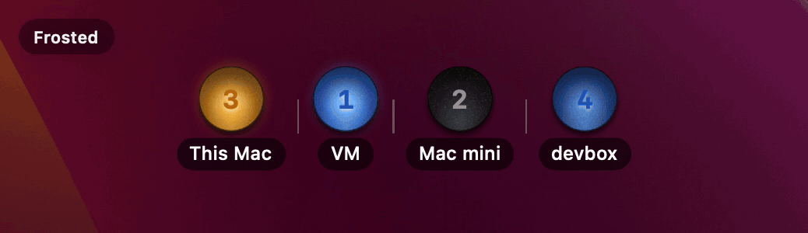

# Claude Tmux Lights

A floating macOS panel with one lamp per Claude Code session running in tmux.

| Lamp | Meaning |
| --- | --- |
| Amber, pulsing | Waiting for you |
| Blue | Busy |
| Blue ring | Only a background shell command is running |
| Dark | Idle |
| Dashed ring | Unknown status |
| Dimmed `–` | Place not connected (see [Troubleshooting](#troubleshooting)) |
| Tiny dot | All places connected, no Claudes running |

The number on a lamp is the tmux window index. Thin lines separate tmux sessions and places. A window with several Claudes in split panes shows the one that most needs you.

## Requirements

- macOS 15 or newer, and Xcode or the command line tools with Swift 6 to build.
- `python3` and `tmux` on the machine where tmux runs.
- For a remote machine, passwordless SSH key login.

## Install

The app is built from source and only ad-hoc signed.

```sh
git clone https://github.com/zion-off/claude-tmux-lights.git
cd claude-tmux-lights
./scripts/bundle.sh
open build/ClaudeTmuxLights.app
```

Claudes in tmux on this Mac show up immediately. The app has no Dock icon. Right-click the panel for Settings and Quit.

## Places

Add places in Settings under Places. A place is shown only while its checkbox is ticked. With more than one place, the right-click menu has a Show submenu to toggle them.

- **This Mac** is there by default. The app runs the backend itself and stops it on quit.
- **Another computer (SSH)** takes an SSH host or `user@host`. The app pipes the backend script to `python3` over SSH, so nothing is installed on the other machine, which needs `python3` and `tmux`. SSH runs with `BatchMode=yes`, so a password prompt fails.
- **A running service** takes `host:port` of a backend you run with `python3 server/claude_traffic.py serve`. It listens on `127.0.0.1:47500` (`--port` to change), so reach it remotely with a port forward. `serve` also sets the tmux window options `@claude_status` and `@claude_color` for use in your status line.

## Settings

The Panel tab has Open at login, Stack the lamps vertically, Show a background behind the lamps (off by default), Keep the panel above other windows (on by default, and it covers fullscreen apps), and options to label each group with its place name and tmux session name. For Open at login, keep the app in Applications so macOS can find it. Reset everything, including the panel position, with `defaults delete dev.local.ClaudeTmuxLights`.

## Troubleshooting

A place that drops shows a dimmed `–` and reconnects by itself every 3 seconds. Hover a lamp to see its place.

- **This Mac never connects.** The app runs `/usr/bin/python3` and looks for tmux on `PATH` plus `/opt/homebrew/bin`, `/usr/local/bin` and `/opt/local/bin`.
- **SSH never connects.** Check `ssh -o BatchMode=yes <host> 'python3 --version && tmux -V'`.
- **A Claude is missing.** It must run inside tmux and have a file in `~/.claude/sessions`.
- **One lone `–` whose hover text is "No place is turned on".** Tick a place under Places.

## How it works

`server/claude_traffic.py` reads `~/.claude/sessions`, maps each Claude to its tmux window, checks once a second, and prints a JSON line when something changes. The app holds one connection per place and reads those lines:

```json
{"v": 1, "claudes": [{"id": "@4", "group": "work", "label": "1", "status": "waiting"}]}
```

`group` is the tmux session, `label` is the lamp text, and `status` is `busy`, `waiting`, `shell` (Claude has stopped and only a background shell command is running) or `idle`. Any TCP port serving such lines works as **A running service**.

## Limitations

- It depends on the files in `~/.claude/sessions`, which are not a documented Claude Code interface and may change.

## For developers

```
Sources/ClaudeTmuxLights/   the app (SwiftUI and AppKit)
server/claude_traffic.py    the backend, bundled into the app
scripts/bundle.sh           builds build/ClaudeTmuxLights.app
tools/make-icon.sh          regenerates the app icon
tools/make-demo.sh          regenerates docs/demo.gif
tools/fake_server.py        replays scripted states for UI testing
```

`python3 tools/fake_server.py 47599 5` serves a test sequence. Add it as **A running service** at `127.0.0.1:47599`.
